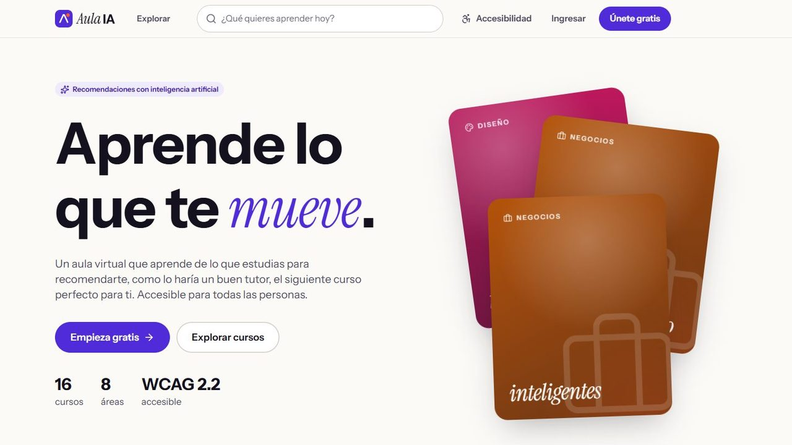
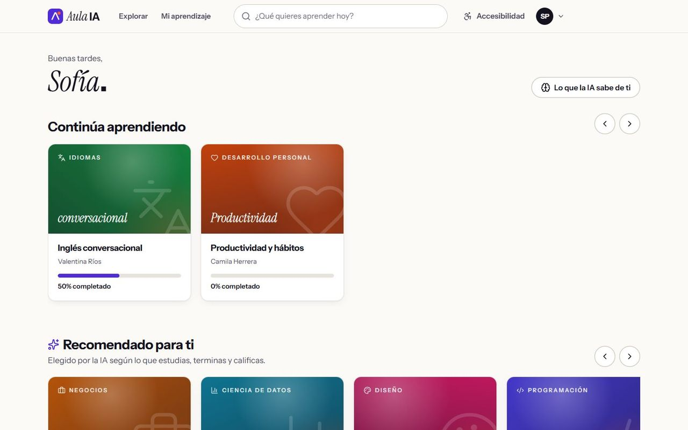
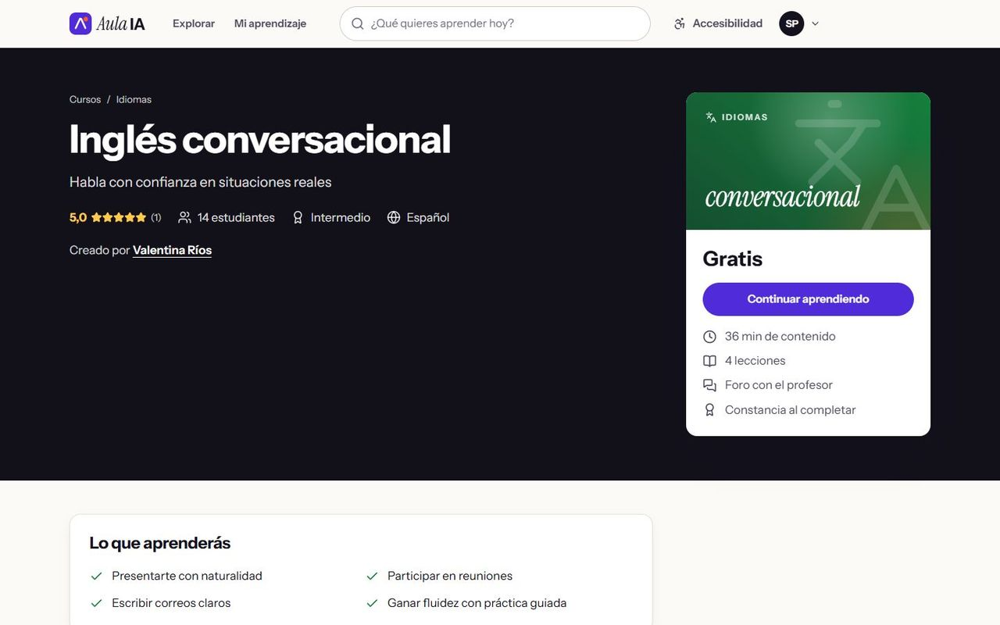
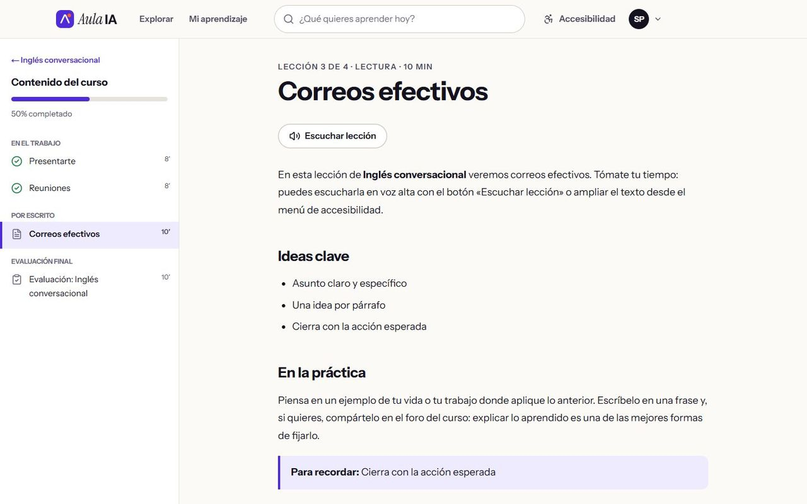
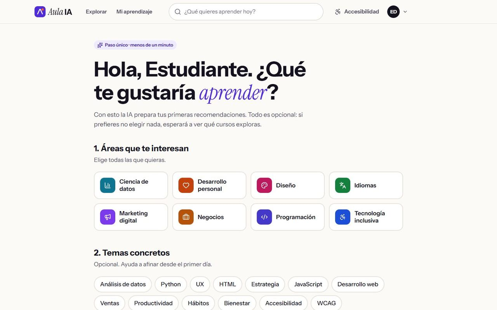
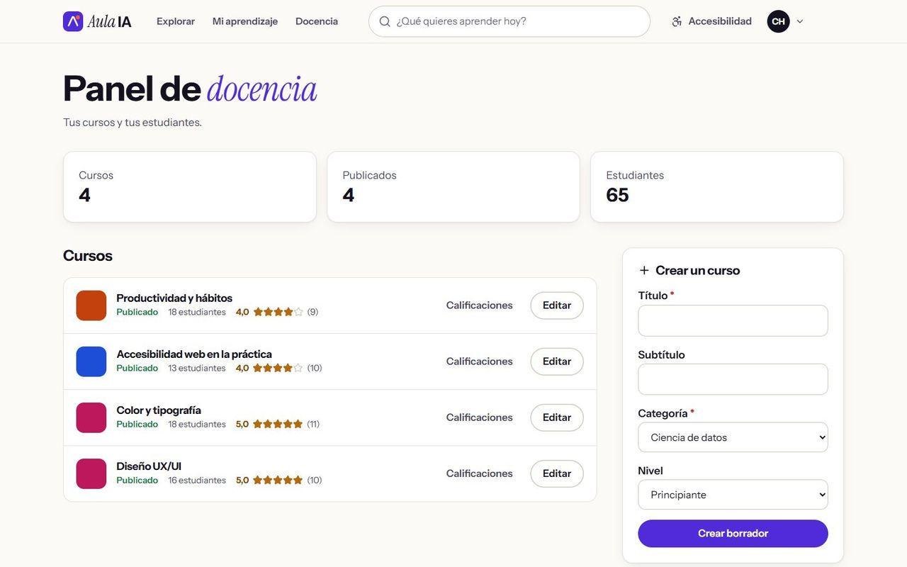
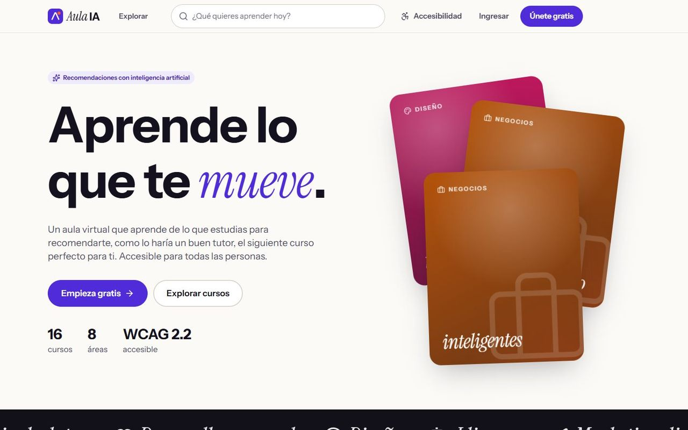
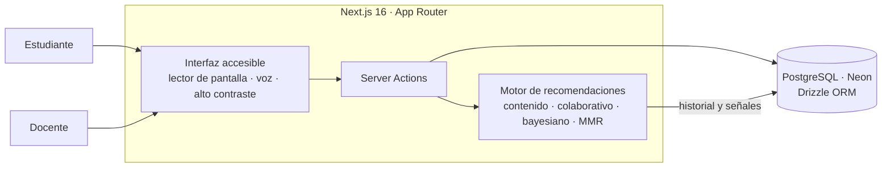

# 🎓 Aula IA · Aula virtual con recomendaciones

**Aula virtual tipo Coursera/Udemy** construida alrededor de un recomendador al estilo Netflix, accesible para personas ciegas y con baja visión.

> 🔒 **Repositorio de presentación.** El código fuente es privado. Aquí encontrarás la descripción, la arquitectura y capturas del sistema. Si quieres conocer el código para un proceso de selección, [escríbeme](mailto:luisda3329@hotmail.com).

---

## 📌 Qué es

Plataforma de cursos con estudiantes, docentes, foros, reseñas y evaluaciones, construida alrededor de un **motor de recomendaciones propio**. La primera vez pregunta los intereses (o los aprende de lo que la persona empieza a ver) y desde ahí arma filas personalizadas que **explican por qué aparece cada curso**.

Todo el sitio está pensado para que lo usen personas que no ven: navegación por lector de pantalla, lectura en voz alta y ajustes de alto contraste, tamaño de texto y fuente de alta legibilidad.

## ✨ Funcionalidades

- 🧠 **Recomendador híbrido:** similitud de contenido + filtrado colaborativo ítem a ítem, popularidad bayesiana, decaimiento temporal y diversidad MMR, cubierto con 16 pruebas.
- ❄️ **Arranque en frío:** bienvenida opcional de intereses o aprendizaje a partir de lo que la persona consume; cada fila explica su razón.
- 📚 **Cursos** con módulos, lecturas, videos con transcripción, evaluaciones calificadas, progreso y constancia al completar.
- 💬 **Foros** por curso, **reseñas** con calificación y **panel de docencia** para crear y publicar cursos.
- ♿ **Accesibilidad WCAG 2.2 AA** verificada con axe: lector de pantalla, lectura en voz alta, alto contraste, texto al 200 % y fuente Atkinson Hyperlegible.
- 🎬 Diseño editorial con GSAP y Lenis que respeta el movimiento reducido.

## 🖼️ Capturas

| | |
|---|---|
|    **Inicio personalizado** con filas de recomendaciones |    **Página de curso** con temario, reseñas y profesor |
|    **Lección** con lectura en voz alta y temario lateral |    **Bienvenida** opcional para elegir intereses |
|    **Panel de docencia** |    **Portada pública** |

## 🏗️ Arquitectura

## 🛠️ Stack

---

Hecho por **[Luis Mercado](https://github.com/luismercado29)** · Diseño y desarrollo full-stack · 2026

© 2026 Luis Mercado. Todos los derechos reservados.

